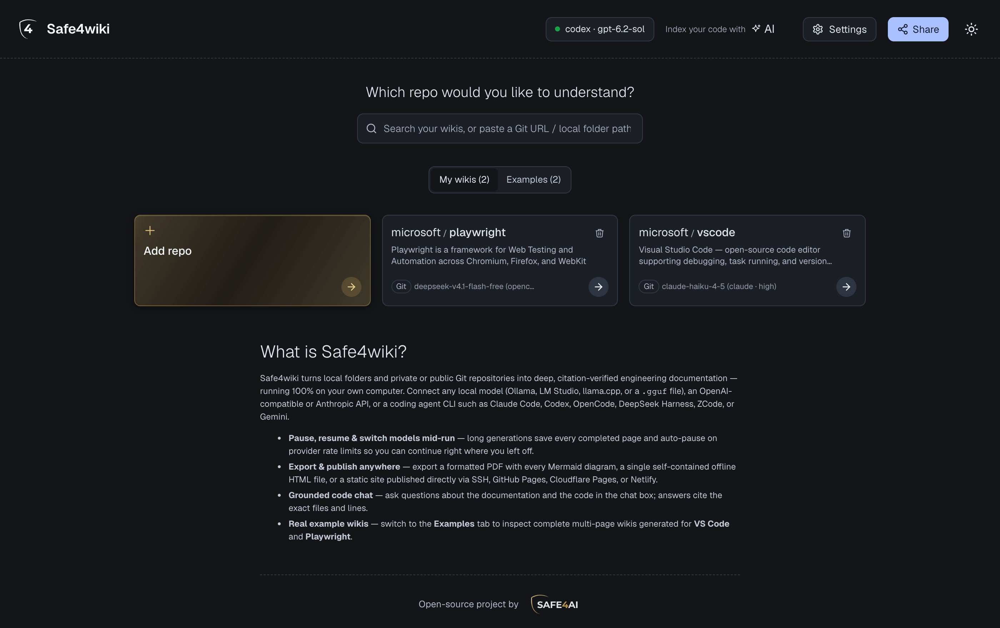
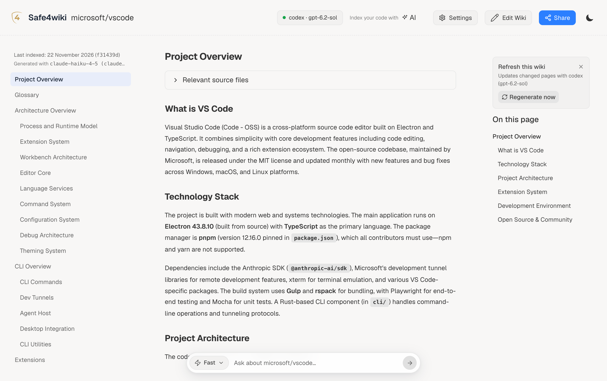
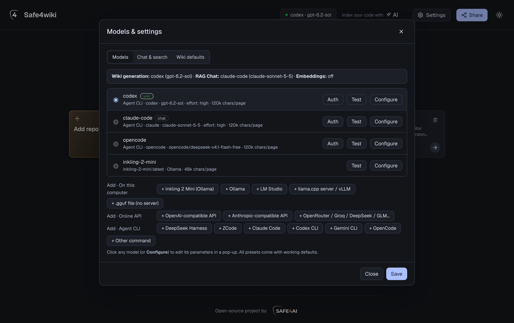
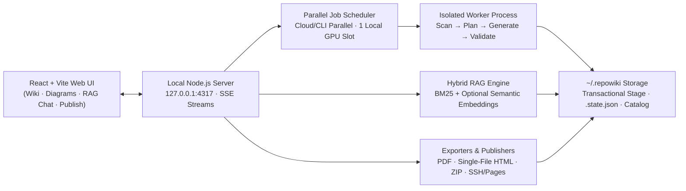

<div align="center">
  
  <h1>Safe4wiki</h1>
  <p><strong>Local-first, privacy-first AI documentation wiki for any codebase.</strong></p>
  <p>
    Turn local folders and private or public Git repositories into deep, citation-verified engineering wikis with rendered Mermaid diagrams, hybrid RAG code chat, offline PDF/HTML exports, and 1-click subdomain publishing — running 100% on your own machine.
  </p>

  <p>
    <a href="https://github.com/Safe4ai-com/Safe4wiki/actions/workflows/ci.yml">
      
    </a>
    <a href="https://github.com/Safe4ai-com/Safe4wiki/releases">
      
    </a>
    <a href="LICENSE">
      
    </a>
    <a href="#quick-start">
      = 18" />
    </a>
    <a href="https://safe4ai.com">
      
    </a>
  </p>

  <p>
    <a href="#quick-start">Quick Start</a> ·
    <a href="#key-features">Features</a> ·
    <a href="#supported-ai-backends">Supported Models</a> ·
    <a href="#benchmark-safe4wiki-vs-deepwikicom">Benchmark</a> ·
    <a href="#architecture">Architecture</a> ·
    <a href="#export--1-click-subdomain-publishing">Export &amp; Publish</a>
  </p>
</div>

<br />

<div align="center">
  <picture>
    <source media="(prefers-color-scheme: dark)" srcset="docs/screenshots/home-dark.png" />
    <source media="(prefers-color-scheme: light)" srcset="docs/screenshots/home-light.png" />
    
  </picture>
</div>

---

## Why Safe4wiki?

Most AI documentation tools force you to upload private source code to a third-party cloud, lock you into a single model, and leave you stuck inside a hosted viewer. **Safe4wiki flips the model:**

- **Your code never leaves your machine** unless you explicitly choose a cloud API — run completely offline with **Ollama**, **LM Studio**, **llama.cpp**, or a raw **`.gguf`** file.
- **Bring any model or coding CLI** — seamlessly switch between local GPUs, OpenAI/Anthropic-compatible APIs, or your existing CLI subscriptions (**Claude Code**, **Codex**, **OpenCode**, **DeepSeek Harness**, **ZCode**, **Gemini CLI**).
- **Never lose progress on large repos** — pause anytime, auto-pause when a provider hits rate/5-hour limits, and resume from the exact next page (even after switching models).
- **Own the output** — export a print-ready **PDF**, a single self-contained **offline HTML** handbook, or publish a static site directly to **your own subdomain** in one click.

---

## Quick Start

**Requirements:** Node.js `>= 18`

### Option A — 1-Click Local App Launcher (macOS)

<a href="Open%20Safe4wiki.command">
  
</a>

After cloning or downloading the repo, double-click **[`Open Safe4wiki.command`](Open%20Safe4wiki.command)** in Finder:
- Automatically installs dependencies and builds the UI on first launch
- Starts the local server and opens **`http://localhost:4317`** in your browser
- Re-clicking while already running opens the browser tab immediately without spawning a duplicate server

*(First launch on macOS: if Gatekeeper prompts, right-click `Open Safe4wiki.command` → **Open** once.)*

### Option B — Terminal (macOS, Linux, Windows)

```bash
git clone https://github.com/Safe4ai-com/Safe4wiki.git
cd Safe4wiki
npm install
npm run build
npm start
```

Safe4wiki opens automatically at **`http://localhost:4317`** with **2 complete, real-world example wikis** already bundled so you can explore the full UI immediately:
- **[`microsoft/vscode`](src/data/demos/vscode.js)** — **60 pages** generated with `claude-haiku-4-5`
- **[`microsoft/playwright`](src/data/demos/playwright.js)** — **49 pages** generated with `deepseek-v4.1-flash-free (opencode)` + `claude-haiku-4-5`

---

## Visual Tour

### Deep, Citation-Grounded Documentation & 3-Level Navigation
Every page is verified against real repository files, cleanly deduplicated into a collapsible **Relevant source files** drawer, tagged with the exact commit & generating model, and paired with a floating **Hybrid RAG** chat bar.



### Auto-Healed Mermaid Architecture Diagrams
Safe4wiki validates and automatically repairs Mermaid syntax (sequence diagrams, flowcharts, class diagrams, state graphs) with an interactive pan/zoom lightbox and instant client-side SVG caching.


### Unified Model Hub — Local, Cloud APIs & Agent CLIs
Configure separate models for wiki generation and chat, trigger 1-click Terminal authentication (`Auth`), pick reasoning effort per CLI, and live-discover installed models from Ollama, OpenCode, and Codex.



### Built-In Step-by-Step Subdomain Publishing Guides
Click **`Share → Publish to my subdomain → ⓘ Setup guide`** for tailored, copyable setup commands covering **SSH / rsync**, **GitHub Pages**, **Cloudflare Pages**, **Netlify**, and custom deploy scripts.


---

## Key Features

<table>
  <tr>
    <td width="50%" valign="top">
      <h3>Deep Multi-Page Wiki Engine</h3>
      <ul>
        <li><strong>Auto-scaling page budget</strong> — adapts automatically from small libraries to 60+ page monorepos with 3-level nested trees and automatic <strong>Glossary</strong> pages.</li>
        <li><strong>Pause, Resume &amp; Auto-Pause</strong> — saves completed pages and the accepted plan to disk; automatically pauses on provider quota/rate limits (including 5-hour CLI limits) so you can resume later or finish with another model.</li>
        <li><strong>Smart Parallel Scheduler</strong> — runs multiple cloud/CLI generations simultaneously across different repos while serializing local GPU models cleanly to prevent VRAM thrashing.</li>
        <li><strong>Transactional &amp; Incremental</strong> — staged builds never corrupt a live wiki; regenerations skip unchanged pages and preserve manual edits.</li>
      </ul>
    </td>
    <td width="50%" valign="top">
      <h3>Hybrid RAG Chat &amp; Code Inspector</h3>
      <ul>
        <li><strong>Hybrid retrieval</strong> — combines BM25 lexical search over wiki sections &amp; source chunks with optional background semantic embeddings (zero startup delay).</li>
        <li><strong>Verified line citations</strong> — streamed answers include clickable file and line-range chips.</li>
        <li><strong>Split-View Code Inspector</strong> — click any cited file to inspect highlighted source code side-by-side without leaving the wiki.</li>
        <li><strong>File attachments &amp; model selector</strong> — attach extra context files and pick a fast dedicated chat model independently from your wiki generator.</li>
      </ul>
    </td>
  </tr>
  <tr>
    <td width="50%" valign="top">
      <h3>Privacy-First Local Architecture</h3>
      <ul>
        <li><strong>Localhost-only server</strong> (<code>127.0.0.1:4317</code>) with zero telemetry.</li>
        <li><strong>Private Git &amp; LFS support</strong> — works with local folders, SSH keys, or HTTPS tokens (stored locally with <code>chmod 600</code> and masked from the browser), skipping Git LFS smudges cleanly.</li>
        <li><strong>Isolated CLI credentials</strong> — keeps per-tool auth sessions clean without interfering with desktop apps.</li>
        <li><strong>Model provenance</strong> — subtly displays <code>Generated with &lt;model&gt;</code> on wiki cards, sidebars, HTML exports, and PDF covers for transparent quality comparisons.</li>
      </ul>
    </td>
    <td width="50%" valign="top">
      <h3 id="export--1-click-subdomain-publishing">Export &amp; 1-Click Subdomain Publishing</h3>
      <ul>
        <li><strong>Single-file offline HTML (<code>*-docs.html</code>)</strong> — self-contained handbook with pre-rendered SVG diagrams, full-text search, and dark/light theme that works directly via <code>file://</code>.</li>
        <li><strong>Print-quality PDF</strong> — cover page, numbered table of contents, and crisp vector diagrams via Chromium/Playwright.</li>
        <li><strong>Static website bundle (ZIP / folder)</strong> — ready for any CDN or static host with instant client-side search.</li>
        <li><strong>1-Click Publish</strong> — deploy straight to <strong>SSH/rsync</strong> (preserves Nginx/Basic Auth/SSL), <strong>GitHub Pages</strong> (auto <code>CNAME</code> + <code>.nojekyll</code>), <strong>Cloudflare Pages</strong>, <strong>Netlify</strong>, or your own shell command.</li>
      </ul>
    </td>
  </tr>
</table>

---

## Supported AI Backends

| Category | Backends | Highlights |
| :--- | :--- | :--- |
| **Local (100% Offline)** | **Ollama**, **LM Studio**, **llama.cpp server / vLLM**, direct **`.gguf`** (`node-llama-cpp`) | Live model list discovery, thinking-token stripping, configurable `num_ctx`, 15-min local timeout, single GPU slot scheduling |
| **Online APIs** | **OpenAI-compatible** (OpenAI, OpenRouter, Groq, DeepSeek, Z.AI/GLM, self-hosted), **Anthropic-compatible** | Configurable concurrency, masked `chmod 600` key storage, `env:VAR_NAME` support |
| **Agent CLIs** | **Claude Code** (`claude`), **Codex** (`codex`), **OpenCode** (`opencode`), **DeepSeek Harness** (`dsh`), **ZCode** (`zcode`), **Gemini CLI** (`gemini`), or **custom CLI** | 1-click Terminal **`Auth`**, per-CLI **reasoning effort** (`low` → `max`/`ultra`), live model discovery (`opencode models` & `~/.codex/models_cache.json`) |

---

## Benchmark: Safe4wiki vs DeepWiki.com

We ran a head-to-head comparison on the exact same public repository and commit — **[`genes8/open-repo-wiki`](https://github.com/genes8/open-repo-wiki) @ `dcfac26`** (101 repository files) — auditing every generated page on disk and live in headless Chrome:

| Metric | **Safe4wiki (Local)** | **DeepWiki.com (Hosted)** |
| :--- | :---: | :---: |
| **Pages generated** | **34** *(auto-scaled, incl. Glossary & 6 Design Docs)* | 33 |
| **Documentation depth** | **36,540 words · 71 structured tables** | ~300–450 words & 0 tables on core pages |
| **Mermaid diagrams (live Chrome render)** | **38 / 38 rendered (100%, 0 errors)** | **3 broken diagrams** across 4 inspected pages |
| **Repository file coverage** | **96 / 101 files (95.0%)** | ~90% |
| **Verified source citations** | **661 / 662 (99.8%)**, deduplicated into 1 drawer/page | Mixed plain-text citations & repeated `Sources:` blocks |
| **Rendering / formatting defects** | **0** | Unrendered raw LaTeX (`Node.js $\ge$ 18`) + broken diagrams |
| **Privacy & model choice** | **100% local** — Ollama, GGUF, BYO API, or Agent CLIs | Cloud-hosted only |
| **Offline export & self-hosting** | Single-file HTML, Print PDF, Static ZIP, 1-click Publish | Web viewer only |

> **Why Safe4wiki renders 100% of Mermaid diagrams:** Safe4wiki ships with a line-anchored fenced-code parser plus an automatic Mermaid sanitizer and retry renderer so tricky labels (parentheses, colons, inline code fences) still render cleanly as crisp SVGs.

---

## Architecture



---

## Configuration & Development

### Environment Variables

| Variable | Default | Description |
| :--- | :--- | :--- |
| `PORT` | `4317` | Local HTTP port (bound strictly to `127.0.0.1`) |
| `REPOWIKI_HOME` | `~/.repowiki` | Directory where settings, generated wikis, embeddings cache, and cloned repos live |

For PDF export, Safe4wiki automatically detects an installed Chrome/Chromium browser or Playwright Chromium (`npx playwright install chromium`), falling back cleanly to browser print view if neither is available.

### Scripts

```bash
npm run build   # Type-check (tsc --noEmit), bundle frontend (Vite), and pre-render static routes
npm test        # Run server, engine, scheduler, pause/resume & export test suite (node --test)
npm start       # Start the local Safe4wiki server at http://localhost:4317
```

---

## SafeSuite Ecosystem

<div align="center">
  <p>Safe4wiki is the flagship open-source product in <strong><a href="https://github.com/Safe4ai-com">SafeSuite</a></strong> — a growing collection of local-first, privacy-respecting AI developer tools created by <strong><a href="https://safe4ai.com">Safe4AI</a></strong>.</p>
  <a href="https://safe4ai.com">
    <picture>
      <source media="(prefers-color-scheme: dark)" srcset="public/brand/logo-horizontal-ondark.svg" />
      <source media="(prefers-color-scheme: light)" srcset="public/brand/logo-horizontal-onlight.svg" />
      
    </picture>
  </a>
</div>

---

## License & Attribution

Licensed under the **[Apache License, Version 2.0](LICENSE)** (`Copyright 2026 Safe4AI`).  
See [`NOTICE`](NOTICE) for attribution details. The wiki generation engine in `server/engine/` incorporates code from `open-repo-wiki` (MIT License — see [`server/engine/LICENSE-open-repo-wiki`](server/engine/LICENSE-open-repo-wiki)).
