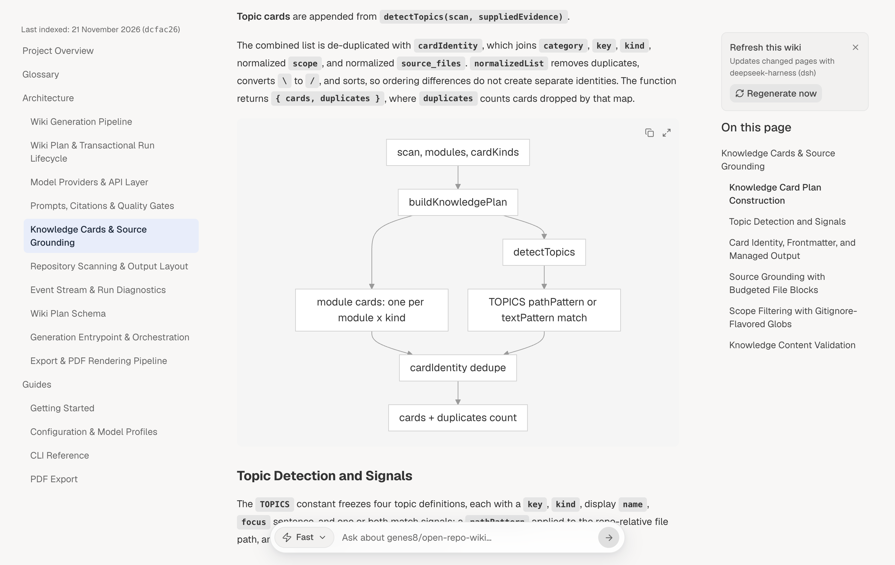
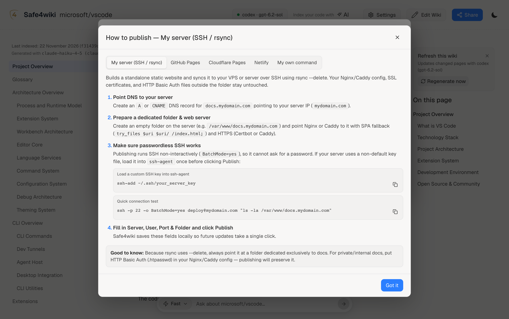

# Safe4wiki

[](https://github.com/Safe4ai-com/Safe4wiki/actions/workflows/ci.yml)
[](LICENSE)
[](https://safe4ai.com)

**Local-first, privacy-first AI documentation wiki for any codebase.**  
Part of **[SafeSuite](https://github.com/Safe4ai-com)** — open-source AI engineering tools by **[Safe4AI](https://safe4ai.com)**.

Generate deep, citation-grounded repository wikis with Mermaid architecture diagrams, explore your codebase through a hybrid RAG assistant with a live split-view code inspector, export offline single-file HTML or print-quality PDFs, and publish directly to your own subdomain — using **local LLMs**, **cloud APIs**, or **agent CLIs**.


---

## Benchmark: Safe4wiki vs DeepWiki.com

We ran a head-to-head comparison on the exact same public repository and commit — **[`genes8/open-repo-wiki`](https://github.com/genes8/open-repo-wiki) @ `dcfac26`** (101 repository files) — auditing every generated page on disk and live in headless Chrome:

| Metric | **Safe4wiki (Local)** | **DeepWiki.com (Hosted)** |
|---|---:|---:|
| **Pages generated** | **34** *(auto-scaled, incl. Glossary & 6 Design Docs)* | 33 |
| **Documentation depth** | **36,540 words** · **71 structured tables** | ~300–450 words & 0 tables on core pages *(Overview: 341w, Engine: 442w, Providers: 273w)* |
| **Mermaid diagrams (live Chrome render)** | **38 / 38 rendered (100%, 0 errors)** | **3 broken diagrams** across 4 inspected pages *(incl. both diagrams on LLM Provider Layer)* |
| **Repository file coverage** | **96 / 101 files (95.0%)** | ~90% |
| **Verified source citations** | **661 / 662 (99.8%)**, cleanly deduplicated into 1 drawer per page | Mixed unlinked plain-text citations & repeated `Sources:` blocks |
| **Rendering / formatting defects** | **0** | Unrendered raw LaTeX (`Node.js $\ge$ 18`) + broken diagrams |
| **Privacy & model choice** | **100% local** — Ollama, LM Studio, GGUF, BYO API, or Agent CLIs | Cloud-hosted only |
| **Offline export & self-hosting** | Single-file offline HTML, Print PDF, Static ZIP, 1-click Publish | Web viewer only |

> **Why Safe4wiki renders 100% of Mermaid diagrams:** Safe4wiki includes an automatic Mermaid sanitizer + retry renderer and fenced-code parser safeguards so tricky labels (parentheses, colons, inline backticks) still render cleanly as crisp SVGs.

---

## Key Features

- **100% Local & Private by Default** — Runs on `localhost:4317`. Works with local folders or private Git repositories (tokens stored locally with `chmod 600` and never exposed to the browser). Ships with 4 built-in public **example wikis** (`vscode`, `transformers`, `playwright`, `MinerU`) so you can explore the UI immediately while your own generated wikis stay private under `~/.repowiki`.
- **Interchangeable AI Backends**
  - **Local models:** Ollama, LM Studio, llama.cpp server, vLLM, or direct `.gguf` inference (`node-llama-cpp`)
  - **Cloud APIs:** Any OpenAI-compatible endpoint (OpenAI, OpenRouter, Groq, DeepSeek, GLM, self-hosted) and Anthropic-compatible endpoints
  - **Agent CLIs:** DeepSeek Harness (`dsh`), ZCode, Claude Code, Codex, Gemini CLI, OpenCode, or any custom CLI command
- **Deep, Grounded Wiki Generation**
  - Auto-scaling page budget (`Auto` adapts from small repos up to 60+ pages with up to 3-level hierarchy)
  - Automatic project **Glossary** and structured landing pages
  - Verified source-file citations deduplicated cleanly into each page's **Relevant source files** drawer
  - Auto-healed **Mermaid** diagrams with pan/zoom lightbox and instant cache
  - Transactional staged builds + incremental regeneration (skips unchanged pages and preserves manual edits)
- **Hybrid RAG Code Assistant**
  - Combines wiki sections and source-code chunks (BM25 + optional background semantic embeddings with zero startup wait)
  - Streamed answers with clickable file & line-range chips
  - On-demand **Split-View Live Code Inspector** and file attachments
- **Export & 1-Click Subdomain Publishing**
  - **Single-file offline HTML (`*-docs.html`)** — self-contained with pre-rendered SVG diagrams, sidebar, search, and dark/light theme (works directly via `file://` with zero external requests)
  - **Print-quality PDF** — cover page, table of contents, and rendered diagrams via Chromium/Playwright
  - **Static Website Export (ZIP or folder)** — with fast client-side search across all pages
  - **Publish to your subdomain** with built-in step-by-step setup guides: **SSH / rsync**, **GitHub Pages** (auto `CNAME` + `.nojekyll`), **Cloudflare Pages**, **Netlify**, or **custom command**

### Architecture Diagrams & Built-in Publishing Guides





---

## Quick Start

**Requirements:** Node.js `>= 18`

### Option A — 1-Click Local App Launcher (macOS)

[](Open%20Safe4wiki.command)

After cloning or downloading the repo, simply double-click **[`Open Safe4wiki.command`](Open%20Safe4wiki.command)** in Finder:
- Automatically installs dependencies and builds the UI on first launch (if not built yet)
- Starts the local Safe4wiki server and opens **`http://localhost:4317`** in your browser
- If Safe4wiki is already running, it opens the browser tab immediately without starting a second server

*(First time on macOS: if Gatekeeper prompts, right-click `Open Safe4wiki.command` → **Open** once.)*

### Option B — Terminal (macOS, Linux, Windows)

```bash
git clone https://github.com/Safe4ai-com/Safe4wiki.git
cd Safe4wiki
npm install
npm run build
npm start
```

Safe4wiki opens automatically at **`http://localhost:4317`**.

---

## First-Time Workflow

1. **Configure a model** — Click **Settings** in the top bar and pick a preset (Ollama, LM Studio, OpenAI/Anthropic API, or an installed Agent CLI such as `dsh`, `claude`, `codex`, `gemini`, `zcode`, or `opencode`), then click **Test**.
2. **Add a repository** — Click **Add repository** on the home screen and point it to a local folder or a Git URL (SSH or HTTPS + token).
3. **Explore & ask** — Browse generated chapters and diagrams, or use the **Ask about …** bar at the bottom to run hybrid RAG queries with clickable source citations and live code inspection.
4. **Export or publish** — Click **Share** to export a single-file offline HTML handbook, print-ready PDF, static hosting bundle, or publish directly to your subdomain (click **`ⓘ Setup guide`** inside the Publish dialog for step-by-step instructions per host).

---

## Configuration

| Environment Variable | Default | Description |
|---|---|---|
| `PORT` | `4317` | Local HTTP port (`127.0.0.1` only) |
| `REPOWIKI_HOME` | `~/.repowiki` | Directory where settings, generated wikis, embeddings cache, and cloned repos are stored |

For PDF export, Safe4wiki automatically uses an installed Chrome/Chromium browser or Playwright Chromium (`npx playwright install chromium`). If neither is available, it falls back cleanly to browser print view.

---

## Development & Testing

```bash
npm run build   # Type-check (tsc --noEmit), bundle frontend (Vite), and generate static routes
npm test        # Run server & preprocessing test suite (node --test)
npm start       # Start the local Safe4wiki server
```

---

## SafeSuite Ecosystem

Safe4wiki is the first open-source product in **[SafeSuite](https://github.com/Safe4ai-com)** — a growing collection of local-first, privacy-respecting AI developer tools created by **[Safe4AI](https://safe4ai.com)**.

Follow the **[Safe4ai-com organization](https://github.com/Safe4ai-com)** for upcoming SafeSuite releases.

---

## License & Attribution

Licensed under the **[Apache License, Version 2.0](LICENSE)** (`Copyright 2026 Safe4AI`).  
See [`NOTICE`](NOTICE) for attribution details. The wiki generation engine in `server/engine/` incorporates code from `open-repo-wiki` (MIT License — see [`server/engine/LICENSE-open-repo-wiki`](server/engine/LICENSE-open-repo-wiki)).
